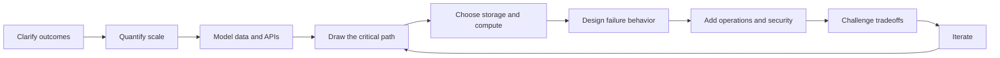
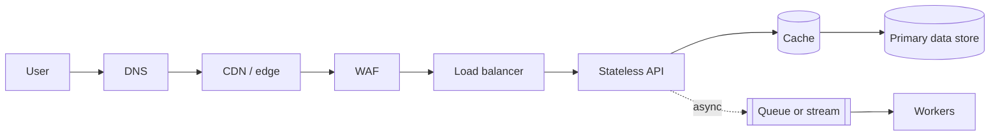
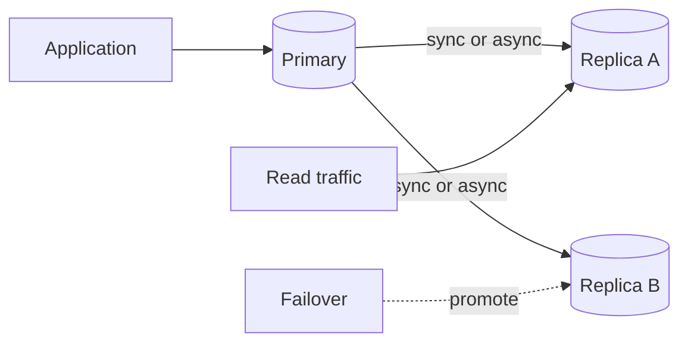
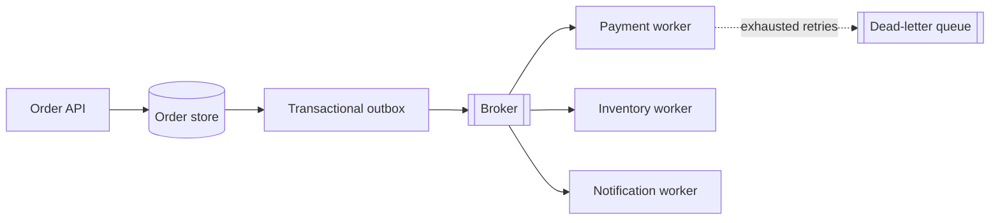
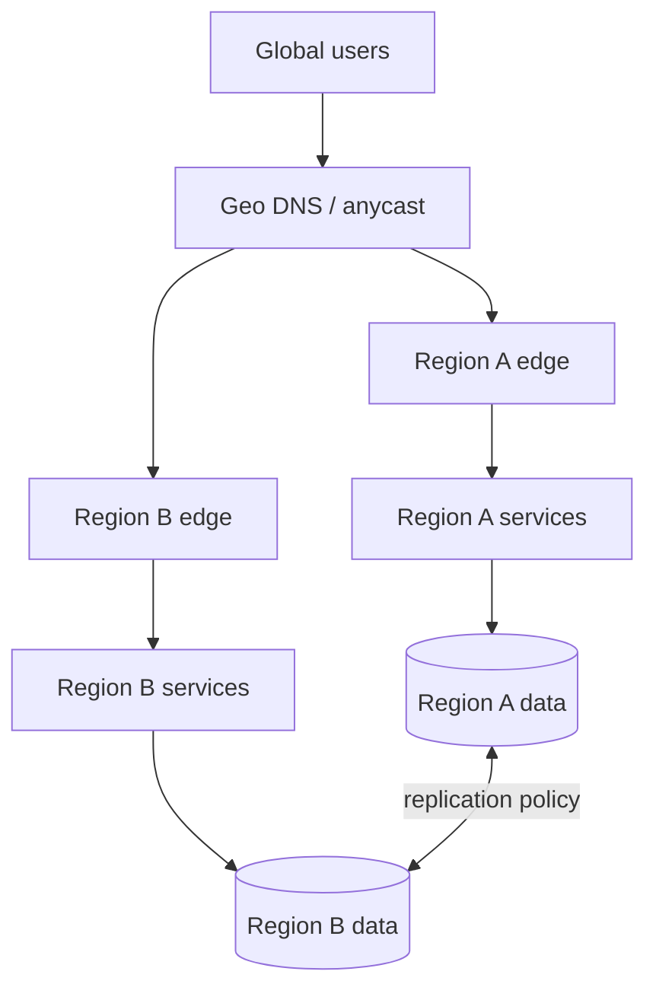

# Cloud Architect Dojo: System Design Handbook

This handbook is the durable companion to the interactive **Cloud Architect Dojo** canvas. Use the guide to build a mental model; use the canvas to make choices, trigger failures, and see the consequences.

> **A good design is not the diagram with the most boxes.** It is the smallest understandable system that meets the important requirements, behaves predictably under failure, and can evolve without heroic operations.

## Table of contents

1. [How to learn with this handbook](#1-how-to-learn-with-this-handbook)
2. [A repeatable design process](#2-a-repeatable-design-process)
3. [Requirements, constraints, and estimation](#3-requirements-constraints-and-estimation)
4. [Networking and request flow](#4-networking-and-request-flow)
5. [Compute and scaling](#5-compute-and-scaling)
6. [Data models and storage](#6-data-models-and-storage)
7. [Caching](#7-caching)
8. [Messaging and event-driven systems](#8-messaging-and-event-driven-systems)
9. [Reliability and disaster recovery](#9-reliability-and-disaster-recovery)
10. [The architecture tradeoff compass](#10-the-architecture-tradeoff-compass)
11. [Observability and SRE signals](#11-observability-and-sre-signals)
12. [Security and abuse resistance](#12-security-and-abuse-resistance)
13. [Multi-region and global systems](#13-multi-region-and-global-systems)
14. [Design review and interview framework](#14-design-review-and-interview-framework)
15. [Common failure modes and anti-patterns](#15-common-failure-modes-and-anti-patterns)
16. [Cloud Architect Dojo scenario labs](#16-cloud-architect-dojo-scenario-labs)
17. [Glossary](#17-glossary)
18. [Trusted further reading](#18-trusted-further-reading)

---

## 1. How to learn with this handbook

### Progressive learning path

| Stage | Learn | Practice in the canvas | Evidence of understanding |
|---|---|---|---|
| **1. Shape the problem** | Requirements, constraints, estimates | Tiny Links, Big Traffic | You can state scale, latency, durability, and cost targets before choosing technology |
| **2. Build the request path** | DNS, load balancing, stateless compute, storage, cache | Tiny Links; Always-On Launchpad | You can trace one request and identify every synchronous dependency |
| **3. Design for failure** | Redundancy, timeouts, retries, failover, graceful degradation | Always-On Launchpad | You can explain what happens when a zone, database, or dependency fails |
| **4. Decouple work** | Queues, streams, idempotency, backpressure, DLQs | Order Stream Command | You can describe delivery semantics and make retries safe |
| **5. Go global** | CDN, multi-region routing, replication, residency, cost | Planet-Scale Premiere | You can define regional ownership and a credible failover plan |
| **6. Operate the system** | SLOs, telemetry, runbooks, security, capacity | Revisit all missions | You can name the signals, alerts, and recovery actions that prove the design works |

### A practical study loop

1. Read one section of this guide.
2. Open the mapped dojo mission.
3. Build the smallest design you believe will work.
4. Write down one prediction before applying an incident.
5. Run the incident and compare the result with your prediction.
6. Change one component at a time.
7. Explain the improvement and the new cost or complexity.

That last step matters: architecture judgment grows when you can explain **why** a design is appropriate, not merely identify a familiar pattern.

---

## 2. A repeatable design process

Use the following loop for a design review, an interview, or the first architecture session for a real product.



### Start with invariants

An invariant is a statement the system must preserve:

- A payment is captured at most once for one order.
- A short code resolves to one destination at a point in time.
- A user cannot read another tenant's private data.
- Confirmed media uploads are not silently lost.

Invariants guide data models, transaction boundaries, idempotency, and recovery. If a team cannot name its invariants, it will discover them during an incident.

### Identify the critical path

The critical path is the minimum synchronous work required to complete the user-visible operation. Every network call on it adds latency and another failure mode.

For each dependency, ask:

- Must this happen before the response?
- What timeout applies?
- Is retry safe?
- What happens if it is slow, unavailable, or returns stale data?
- Can the work move behind a queue?

### Prefer explicit boundaries

Define:

- **Ownership:** which service owns each piece of data?
- **Consistency boundary:** which changes must be atomic?
- **Failure boundary:** what can fail without taking down the whole product?
- **Scaling boundary:** what workload needs to scale independently?
- **Trust boundary:** where must identity and authorization be re-evaluated?

---

## 3. Requirements, constraints, and estimation

### Functional requirements

Functional requirements describe what users and systems can do:

- Create and resolve a short URL.
- Submit an order and view its status.
- Upload media and start playback.
- Fail over traffic when a region is unhealthy.

Prioritize the essential flows. A useful design can go deep on three important operations; an unfocused design can remain shallow across twenty.

### Non-functional requirements

Non-functional requirements define how well the system must behave.

| Dimension | Questions to clarify |
|---|---|
| **Scale** | Requests per second? Concurrent users? Data growth? Read/write ratio? |
| **Latency** | Average or percentile? End-to-end or service-only? Which user regions? |
| **Availability** | What SLO is required? Is planned maintenance included? |
| **Durability** | How much confirmed data loss is acceptable? |
| **Consistency** | Which reads must reflect the latest write? Where is stale data acceptable? |
| **Recovery** | Required recovery time objective (RTO) and recovery point objective (RPO)? |
| **Security** | Data sensitivity, tenant isolation, compliance, abuse cases? |
| **Cost** | Hard budget, unit economics, or cost-per-request target? |
| **Operability** | On-call maturity, deployment frequency, audit and debugging needs? |

Translate vague words into measurable targets. “Fast” becomes “p95 under 150 ms in the primary market.” “Highly available” becomes “99.95% successful requests per calendar month.”

### Constraints

Constraints narrow the solution space:

- Existing cloud, database, identity provider, or networking platform.
- Team skills and operational capacity.
- Migration compatibility and legacy protocols.
- Legal boundaries and data residency.
- Launch deadline and expected product uncertainty.
- Vendor contracts, cost commitments, or portability goals.

Constraints are not automatically bad. A clear constraint can prevent unnecessary option analysis.

### Back-of-the-envelope estimation

Estimation is not prediction theater. It reveals the order of magnitude and likely bottlenecks.

#### Core formulas

```text
average requests/second = daily requests / 86,400
peak requests/second    = average RPS × peak factor

daily storage growth    = writes/day × average record size
annual storage          = daily growth × 365 × replication factor

bandwidth               = requests/second × average payload size
concurrent work         ≈ arrival rate × average processing time
```

The last relationship is Little's Law in a practical form. At 2,000 requests/second and 0.2 seconds average time in the system, roughly 400 requests are in flight.

#### Example: URL redirect service

Assume:

- 200 million redirects/day.
- Peak traffic is 5× average.
- Average response payload is 700 bytes.
- 5 million new links/day.
- Each stored mapping plus metadata is roughly 500 bytes.

Approximate:

```text
average read RPS ≈ 200,000,000 / 86,400 ≈ 2,315
peak read RPS    ≈ 11,600
egress at peak   ≈ 11,600 × 700 B ≈ 8.1 MB/s
new data/day     ≈ 5,000,000 × 500 B ≈ 2.5 GB
```

This suggests a read-heavy design where caching can remove substantial database load. It does **not** yet determine a vendor, database product, or exact instance count.

### Estimate the right things

Estimate:

- Peak, not only average, demand.
- Read and write traffic separately.
- Hot-key concentration.
- Retention and replication overhead.
- Retry amplification during failure.
- Queue backlog growth when consumers slow down.
- Cache-miss load on the origin.

State assumptions and use ranges. A transparent rough estimate is more valuable than a precise number built on hidden guesses.

---

## 4. Networking and request flow

### A typical request path



Trace this path for reads and writes separately. They often need different optimizations and failure behavior.

### DNS

DNS maps names to endpoints and can steer traffic by geography, latency, weight, or health.

Key tradeoffs:

- DNS responses are cached. Low time-to-live (TTL) improves traffic movement but increases resolver load.
- DNS health checks can remove a failed region, but clients may keep stale answers.
- DNS failover is usually measured in seconds or minutes, not instantaneous request-level routing.
- DNSSEC authenticates DNS data; it does not encrypt application traffic.

### CDN

A content delivery network serves cacheable content near users and shields the origin.

Good CDN candidates:

- Versioned static assets.
- Images and media segments.
- Public downloads.
- Cacheable API responses with well-defined keys and privacy controls.

Be explicit about cache keys, TTLs, invalidation, authorization, range requests, and stale-serving behavior. A CDN can reduce latency and origin cost, but a poor cache key can leak data between users.

### Load balancers

Load balancers distribute traffic and remove unhealthy targets.

| Layer | Common use | Important concerns |
|---|---|---|
| **Transport / Layer 4** | TCP or UDP forwarding, very high throughput | Limited application awareness |
| **Application / Layer 7** | HTTP routing by host, path, header, or method | More features and processing overhead |
| **Global** | Route users among regions | Health signal quality, propagation time, residency |

Algorithms include round robin, least connections, weighted routing, and consistent hashing. Sticky sessions can simplify legacy stateful applications, but stateless services are usually easier to scale and fail over.

### Reverse proxies and API gateways

A reverse proxy sits in front of services. An API gateway typically adds product-level controls such as:

- Authentication and token validation.
- Routing and protocol translation.
- Rate limiting and quotas.
- Request/response transformation.
- API versioning and analytics.

Avoid turning the gateway into a giant business-logic service. Centralizing cross-cutting policy is useful; centralizing every product rule creates a bottleneck in ownership and deployment.

### Network principles

- Encrypt external and sensitive internal traffic.
- Use private connectivity and segmentation for internal services.
- Treat every network call as a failure opportunity.
- Set explicit connection, request, and idle timeouts.
- Reuse connections where safe.
- Bound payload sizes.
- Propagate request IDs and trace context.
- Know where TLS terminates and where identity is verified.

---

## 5. Compute and scaling

### Vertical and horizontal scaling

| Strategy | Strengths | Limits |
|---|---|---|
| **Vertical scaling** | Simple; fewer nodes; useful for stateful systems | Hardware ceiling; larger failure unit; expensive jumps |
| **Horizontal scaling** | Elastic capacity; smaller failure units | Requires distribution, coordination, and load balancing |

Most production systems use both: right-size each node, then add nodes as demand grows.

### Stateless services

A stateless service does not require the next request to reach the same process. Durable state, sessions, and coordination live in external systems.

Benefits:

- Any healthy instance can serve a request.
- Auto scaling and rolling deployment become simpler.
- Failed instances can be replaced rather than repaired.

Costs:

- External state stores become critical dependencies.
- Network latency replaces in-process access.
- Request context and idempotency must be explicit.

### Containers, virtual machines, and serverless

| Model | Best fit | Watch for |
|---|---|---|
| **Virtual machines** | Full OS control, legacy workloads, special agents | Slow provisioning, patching, lower density |
| **Containers** | Portable services, controlled runtime, steady workloads | Orchestration complexity, capacity planning |
| **Functions / serverless** | Event-driven or bursty work, small operational team | Cold starts, execution limits, vendor coupling, per-request cost |

Choose the operating model that fits the workload and team. “Serverless” removes server management from the application team; it does not remove capacity limits, security, networking, data design, or observability.

### Auto scaling

Useful scaling signals include:

- CPU or memory saturation.
- Requests per target.
- Queue depth and oldest-message age.
- Concurrent executions.
- Custom business throughput.

Scale on a signal that leads user pain rather than follows it. CPU may be irrelevant for an I/O-bound service; queue age may describe customer delay better than queue length.

Account for:

- Startup and warm-up time.
- Downstream database capacity.
- Minimum safe capacity.
- Scale-in stabilization.
- Regional and zonal placement.
- Retry storms that look like legitimate demand.

### Concurrency and load shedding

Every service should have a bounded amount of work it will accept. Without bounds, overload consumes memory, threads, connections, and eventually the whole process.

Use:

- Connection and worker pools.
- Queue limits.
- Admission control.
- Per-tenant quotas.
- Priority lanes for critical traffic.
- Fast rejection with `429` or `503` when capacity is exhausted.

Load shedding is often kinder than letting every request time out.

---

## 6. Data models and storage

Start with access patterns and invariants, not database categories.

Ask:

- What entities exist and how are they related?
- Which queries dominate?
- Which fields require uniqueness?
- What must update atomically?
- How large can one item or partition become?
- How are records retained, deleted, audited, and restored?

### SQL and NoSQL

| Choice | Strong fit | Tradeoffs |
|---|---|---|
| **Relational / SQL** | Transactions, joins, constraints, evolving queries | Horizontal partitioning can be complex |
| **Key-value** | Known-key lookups, sessions, mappings, counters | Limited querying; denormalization |
| **Document** | Aggregate-oriented records, flexible fields | Cross-document constraints are harder |
| **Wide-column** | Large partitioned datasets, high write throughput | Query model must be designed up front |
| **Graph** | Relationship traversal and path queries | Specialized operations and scaling model |
| **Time-series** | Metrics and timestamped measurements | Narrow workload; retention and cardinality concerns |
| **Object storage** | Durable blobs, media, backups, data lakes | Not a low-latency transactional database |

“NoSQL” is not one consistency or scaling model. Evaluate the guarantees of the specific system.

### Indexes

An index trades write cost and storage for faster reads.

Design indexes from actual query patterns:

- Equality and range filters.
- Sort order.
- Selectivity.
- Covering fields.
- Prefix order in compound indexes.

Too few indexes create scans. Too many slow writes, increase storage, and complicate migrations. Monitor query plans and production cardinality rather than assuming an index is used.

### Replication

Replication copies data to improve durability, availability, and read capacity.



- **Synchronous replication** reduces acknowledged data loss but increases write latency and can reduce availability during network partitions.
- **Asynchronous replication** improves write latency and regional independence but allows replica lag and non-zero RPO.
- Read replicas scale some reads, but stale reads and read-after-write behavior must be understood.

A replica is not a backup. Logical corruption, accidental deletion, and bad writes can replicate too.

### Partitioning and sharding

Partitioning divides data so multiple nodes can store and process it.

Common strategies:

- **Hash partitioning:** distributes load evenly; weak for range scans.
- **Range partitioning:** supports ordered access; vulnerable to hot ranges.
- **Directory-based partitioning:** flexible mapping; directory becomes critical metadata.
- **Geographic partitioning:** improves residency and latency; complicates global queries.

Choose a partition key with:

- High cardinality.
- Even traffic and data distribution.
- Alignment with common queries.
- A plan for exceptionally large tenants or hot keys.

Rebalancing, resharding, and cross-shard operations are part of the design—not future implementation details.

### Consistency

Consistency is observed behavior, not a database marketing label.

Useful guarantees include:

- **Strong consistency:** reads observe the latest completed write.
- **Read-your-writes:** a user sees their own updates.
- **Monotonic reads:** a user does not move backward in observed state.
- **Eventual consistency:** replicas converge if writes stop.

Stronger guarantees simplify application reasoning but can increase latency or reduce availability across unreliable networks.

### CAP-related tradeoffs

During a network partition, a distributed data system must choose how an operation balances:

- **Consistency:** every successful read sees an agreed current value.
- **Availability:** every request receives a non-error response.
- **Partition tolerance:** the system continues despite lost or delayed network messages.

Real distributed systems must tolerate partitions, so the useful question is: **for this operation, during a partition, do we reject work to preserve consistency or accept work with weaker coordination?**

Different operations in one product may choose differently. A social feed can tolerate stale reads; a unique username claim or financial ledger entry may require coordination.

### Transactions

Transactions preserve invariants across related changes.

- Keep transaction boundaries small.
- Avoid network calls inside database transactions.
- Define isolation requirements; “transactional” does not always mean serial execution.
- Use optimistic concurrency when conflicts are rare.
- Use row or advisory locks carefully when conflicts are expected.

Across services, prefer explicit workflows, idempotency, and compensation over a global distributed transaction unless the infrastructure and business case clearly justify it.

---

## 7. Caching

Caching improves latency and reduces downstream load by serving reusable data from a faster layer.

### Common patterns

| Pattern | Flow | Best for | Main risk |
|---|---|---|---|
| **Cache-aside** | App checks cache, loads store on miss, fills cache | General read-heavy systems | Stale data and cold misses |
| **Read-through** | Cache loads from store | Centralized cache behavior | Cache becomes more coupled |
| **Write-through** | Write cache and store synchronously | Read-after-write behavior | Higher write latency |
| **Write-behind** | Cache accepts write, store updates later | High write throughput | Data loss and reconciliation complexity |
| **Refresh-ahead** | Refresh before expiry | Predictable hot data | Waste for unused entries |

### Cache keys and correctness

A cache key must include every input that changes the response:

- Resource identity.
- Tenant or user boundary.
- Locale and content negotiation.
- Authorization scope when responses differ by permission.
- API or schema version.

Do not cache sensitive personalized data under a shared key.

### Invalidation

Common approaches:

- Short TTL and tolerate temporary staleness.
- Delete or update cache entries after a successful write.
- Version keys so deployments or schema changes naturally bypass old entries.
- Publish invalidation events.
- Serve stale data while revalidating.

Invalidation needs a failure policy. If invalidation fails, will the system retry, rely on TTL, or risk serving incorrect data indefinitely?

### Stampedes and hot keys

A stampede occurs when many requests miss or expire together and overwhelm the origin.

Mitigations:

- Add random TTL jitter.
- Coalesce concurrent loads with a per-key lock or single-flight mechanism.
- Refresh hot entries before expiry.
- Serve stale values during refresh.
- Rate-limit origin fetches.
- Replicate or specially handle hot keys.

### Eviction

Typical policies include least recently used (LRU), least frequently used (LFU), and TTL-based expiration. The right policy depends on reuse patterns and memory cost.

Track hit rate **and** origin load. A high aggregate hit rate can hide one expensive miss class; a lower hit rate may still be effective if it protects the costliest reads.

---

## 8. Messaging and event-driven systems

Messaging decouples producers from consumers in time, throughput, and availability.



### Queue or stream?

| Model | Use when | Key idea |
|---|---|---|
| **Work queue** | One worker should process each task | Competing consumers divide work |
| **Publish/subscribe** | Multiple consumers need an event | Each subscription receives its own delivery |
| **Durable stream/log** | Replay, ordered partitions, analytics, change propagation | Consumers track position in an append-only history |

### Delivery semantics

- **At-most-once:** messages may be lost but are not redelivered.
- **At-least-once:** messages are retried; duplicates are possible.
- **Effectively once:** duplicates may arrive, but idempotent processing makes the business outcome occur once.

“Exactly once” usually has a defined boundary. Verify whether it applies to broker delivery, stream processing state, or the final external side effect.

### Idempotency

An operation is idempotent when repeating it with the same intent does not create an additional business effect.

Practical pattern:

1. Client sends an idempotency key.
2. Service atomically records the key and outcome.
3. Retries with the same key return the stored outcome.
4. The key has a retention policy aligned with retry behavior.

For consumers, store a message ID or business key with the state transition. The deduplication write and business update should share a transaction where possible.

### Ordering

Global ordering is expensive and rarely necessary. Define the smallest useful ordering scope:

- Per account.
- Per order.
- Per device.
- Per partition key.

More partitions increase throughput but reduce the scope over which ordering is naturally preserved.

### Backpressure

Backpressure prevents producers from overwhelming consumers.

Watch:

- Queue depth.
- Oldest-message age.
- Consumer processing time.
- Retry volume.
- Partition imbalance.

Responses include scaling consumers, slowing producers, rejecting low-priority work, batching, or degrading optional features. Unlimited buffering delays failure rather than removing it.

### Dead-letter queues

A DLQ isolates messages that exhausted retries.

A complete DLQ design includes:

- Alarm and ownership.
- Original payload and failure context.
- Retention and privacy handling.
- Diagnosis workflow.
- Safe replay with idempotency.
- A way to skip or repair poison messages without blocking healthy traffic.

### Transactional outbox

The dual-write problem appears when a service updates its database and publishes an event separately. One can succeed while the other fails.

A transactional outbox writes the business change and an event record in the same database transaction. A relay later publishes the event. Consumers must still handle duplicates.

---

## 9. Reliability and disaster recovery

### Reliability is layered

Redundant application servers do not create an available product if the session store, database, DNS, deployment system, or operational process remains a single point of failure.

For every critical dependency, define:

- Redundancy model.
- Failure detection.
- Timeout.
- Retry policy.
- Capacity during failover.
- Recovery procedure.
- Data-loss bound.

### Health checks

- **Liveness:** should this process be restarted?
- **Readiness:** should this instance receive traffic?
- **Dependency health:** is a required downstream capability available?

Do not make liveness depend on every downstream service; a shared dependency failure can trigger a restart storm. Readiness can be stricter, but must avoid removing all capacity because of a partial degradation.

### Timeouts

Every remote call needs a timeout. It should fit inside the caller's remaining deadline.

If a request has a 1-second end-to-end budget, three nested services cannot each wait 1 second. Propagate deadlines and reserve time for fallback and response serialization.

### Retries with backoff and jitter

Retry only transient errors and only when the operation is safe.

Use:

- A small attempt limit.
- Exponential backoff.
- Random jitter to avoid synchronized retries.
- A total deadline.
- Retry budgets so retries do not dominate healthy traffic.

Never blindly retry non-idempotent operations.

### Circuit breakers

A circuit breaker temporarily stops calls to a failing dependency.

States:

- **Closed:** calls flow normally.
- **Open:** fail fast or use fallback.
- **Half-open:** allow limited probes to test recovery.

Circuit breakers protect callers and help dependencies recover, but thresholds and fallback behavior must be observable.

### Bulkheads

Bulkheads isolate resource pools so one workload cannot consume everything:

- Separate thread or connection pools.
- Per-tenant concurrency limits.
- Dedicated worker groups.
- Priority queues.
- Independent regional cells.

### Graceful degradation

Define what the product can do without each dependency:

- Serve cached data.
- Disable recommendations.
- Accept an order and delay notifications.
- Lower media quality.
- Switch to read-only mode.
- Reject optional analytics while preserving the critical path.

Fallbacks must be tested. A fallback that has never handled production volume may fail exactly when needed.

### Disaster recovery

| Term | Meaning | Example |
|---|---|---|
| **RTO** | Maximum acceptable time to restore service | Checkout restored within 30 minutes |
| **RPO** | Maximum acceptable confirmed data loss | No more than 5 minutes of orders |

Recovery patterns:

- **Backup and restore:** lowest cost, longest recovery.
- **Pilot light:** critical data/services remain running at small scale.
- **Warm standby:** reduced-capacity secondary environment is continuously available.
- **Active-active:** multiple regions serve traffic simultaneously.

Backups require restore tests, integrity checks, retention, access controls, and dependency inventories. “Backup succeeded” is not the same as “recovery succeeded.”

### Availability math

Serial dependencies reduce availability. If two required services are each 99.9% available and failures are independent:

```text
combined availability ≈ 0.999 × 0.999 = 99.8001%
```

Redundancy can improve availability only when replicas do not share the same failure mode and failover works.

---

## 10. The architecture tradeoff compass

Every meaningful design choice moves several dimensions.

| Optimize for | Common techniques | What may get worse |
|---|---|---|
| **Lower latency** | Cache, CDN, denormalization, regional placement | Freshness, complexity, cost |
| **Higher availability** | Redundancy, failover, graceful degradation | Cost, consistency, operations |
| **Stronger consistency** | Synchronous coordination, transactions, single writer | Latency, partition availability |
| **Higher throughput** | Partitioning, batching, async processing | Ordering, simplicity, tail latency |
| **Lower cost** | Consolidation, longer TTLs, scale-to-zero | Recovery speed, latency, isolation |
| **Lower complexity** | Managed services, fewer components, shared platform | Flexibility, portability, specialized optimization |
| **Stronger security** | Strict authorization, segmentation, encryption, review gates | Friction, latency, operational work |

Use a tradeoff statement:

> We choose **X** to improve **Y**, accepting **Z**, because the requirement prioritizes **R**.

Example:

> We choose asynchronous click analytics to protect redirect latency, accepting delayed metrics, because redirect availability is more important than real-time reporting.

### Cost is architectural

Estimate:

- Compute and storage.
- Data transfer, especially cross-zone and cross-region.
- Managed service requests and retained messages.
- Observability volume.
- Idle failover capacity.
- Engineering and on-call load.

The cheapest infrastructure can be the most expensive system if it creates constant operational work.

---

## 11. Observability and SRE signals

Observability should answer:

1. Is the user experience healthy?
2. Which dependency or change explains the problem?
3. What action should the operator take?

### The core signals

For request-driven services, start with:

- **Latency:** especially p95 and p99.
- **Traffic:** request or transaction rate.
- **Errors:** user-visible failures and incorrect outcomes.
- **Saturation:** constrained resources such as CPU, memory, threads, connections, or queue age.

For asynchronous systems, add:

- Queue depth and oldest-message age.
- Consumer lag.
- Retry and DLQ rate.
- Processing success and end-to-end completion delay.

### Metrics, logs, and traces

| Signal | Best for | Avoid |
|---|---|---|
| **Metrics** | Trends, alerts, SLOs, capacity | Unbounded label cardinality |
| **Logs** | Detailed events and forensic context | Logging secrets or every success at high volume |
| **Traces** | Cross-service latency and causal paths | Sampling without preserving important failures |

Use consistent service names, environment labels, request IDs, trace IDs, tenant-safe identifiers, and deployment versions.

### SLI, SLO, and error budget

- **SLI:** measured indicator, such as successful requests under 300 ms.
- **SLO:** target, such as 99.9% over 28 days.
- **Error budget:** allowed unreliability implied by the SLO.

Alert on user impact and budget burn, not every internal fluctuation. A useful alert is actionable, urgent, and owned.

### Operational readiness

Before launch:

- Define dashboards and alerts.
- Write runbooks for likely failures.
- Test rollback and failover.
- Measure capacity and limits.
- Assign service ownership.
- Record dependencies and escalation paths.
- Practice one realistic game day.

---

## 12. Security and abuse resistance

Security is a design constraint, not a final review step.

### Authentication and authorization

- **Authentication** establishes identity.
- **Authorization** decides whether that identity can perform an action on a resource.

Validate authorization at the service that owns the resource. Do not rely only on a gateway check when internal callers can bypass it or when resource context is required.

Use least privilege for users, services, operators, and automation. Prefer short-lived credentials and workload identity over long-lived static keys.

### Encryption

- Use TLS for data in transit.
- Encrypt sensitive data at rest.
- Separate data encryption from key management.
- Rotate keys and define emergency revocation.
- Consider field-level protection for exceptionally sensitive values.

Encryption does not replace authorization, logging, deletion, or data minimization.

### Secrets

- Store secrets in a managed secret system, not source code or images.
- Limit who and what can read each secret.
- Rotate automatically where practical.
- Avoid exposing secrets in logs, metrics, traces, crash dumps, or URLs.
- Design services to reload rotated credentials safely.

### Rate limiting

Rate limits protect fairness, cost, and availability.

Common algorithms:

- Token bucket for controlled bursts.
- Leaky bucket for smooth output.
- Fixed or sliding windows for quotas.

Choose the key: IP, user, tenant, API token, endpoint, or a combination. Return useful retry information and distinguish abuse controls from capacity protection.

### Threat-aware design

Ask:

- What assets are valuable?
- Where are trust boundaries?
- How could input be forged, replayed, amplified, or made expensive?
- Can one tenant affect another?
- What happens when an internal service is compromised?
- Which actions need audit evidence?

Useful controls include validation, output encoding, replay protection, idempotency, quotas, WAF rules, network segmentation, dependency scanning, secure defaults, and tamper-resistant audit logs.

Security features have failure modes too. Decide whether an unavailable authorization or key service should fail closed, degrade, or use a narrowly scoped cached decision.

---

## 13. Multi-region and global systems

Go multi-region only for a requirement: latency, availability, sovereignty, disaster recovery, or capacity. A second region multiplies data, deployment, networking, observability, and incident complexity.

### Common patterns

| Pattern | Benefits | Tradeoffs |
|---|---|---|
| **Single region, multi-zone** | Strong baseline availability, simpler data model | Regional disaster remains |
| **Active-passive** | Clear ownership, simpler writes | Idle cost, failover delay, possible data loss |
| **Active-active, single writer** | Global reads and fast traffic failover | Remote write latency or routing complexity |
| **Active-active, multi-writer** | Local writes and regional autonomy | Conflict resolution and weaker global invariants |
| **Cell-based architecture** | Limits blast radius and noisy neighbors | Routing and fleet management complexity |

### Global request flow



Define:

- How traffic chooses a region.
- Whether users or tenants have a home region.
- Where writes are accepted.
- How data replicates.
- What consistency clients observe after failover.
- How capacity is reserved.
- How operators declare a region unhealthy and restore it.

### Conflict resolution

Multi-writer systems need a domain policy:

- Last-write-wins.
- Version vectors or causal metadata.
- Mergeable data types.
- Per-entity leader.
- Human reconciliation.
- Reject concurrent updates.

The database cannot invent correct business semantics. “Newest timestamp wins” may be wrong for inventory, balances, or permissions.

### Data residency

Residency requirements can govern where data is collected, processed, stored, backed up, and accessed.

Classify:

- Customer content.
- Identity data.
- Billing and legal records.
- Telemetry and support data.
- Backups and derived datasets.

Design routing, replication, encryption keys, operator access, and deletion around these boundaries. A global control plane can accidentally move metadata across a residency boundary even when primary records remain local.

### Origin protection

For global media or downloads:

- Use layered caches.
- Add an origin shield.
- Coalesce cache misses.
- Pre-warm known launches.
- Stagger expiration with jitter.
- Keep independent failover origin capacity.
- Degrade quality before dropping the experience.

---

## 14. Design review and interview framework

Use **SCALE** as a compact review checklist.

### S — Scope the outcome

- Primary users and workflows.
- Functional requirements.
- SLOs and security obligations.
- Explicit non-goals.

### C — Calculate and constrain

- Peak read/write traffic.
- Payload and storage growth.
- Retention.
- Hot keys and burst factors.
- Budget, team, platform, and deadline constraints.

### A — Architect the critical paths

- APIs and data model.
- Read and write flows.
- Compute and storage choices.
- Cache and asynchronous boundaries.
- Ownership and transaction boundaries.

### L — Limit failure and load

- Timeouts, retries, idempotency.
- Redundancy and failover.
- Backpressure and load shedding.
- Graceful degradation.
- RTO, RPO, backup, and restore.

### E — Explain operations and tradeoffs

- SLI/SLO and alerts.
- Security and abuse controls.
- Deployment and rollback.
- Cost drivers.
- Rejected alternatives.
- Next bottleneck at 10× scale.

### Review questions

1. What is the single most important user journey?
2. Which dependency dominates its latency?
3. Which state transition must never be duplicated or lost?
4. What fails first at peak load?
5. What happens when a dependency is slow rather than fully down?
6. How does the system recover after retries have been exhausted?
7. What can be stale, delayed, or temporarily unavailable?
8. How is tenant isolation enforced?
9. Which dashboards prove the SLO?
10. What complexity can be postponed until evidence demands it?

### Communicating a design

Present in layers:

1. Requirements and estimates.
2. High-level diagram.
3. Critical read and write flows.
4. Data and consistency decisions.
5. Failure and recovery behavior.
6. Security and operations.
7. Tradeoffs and evolution path.

Name uncertainty. A design review is stronger when it distinguishes facts, assumptions, and decisions.

---

## 15. Common failure modes and anti-patterns

| Anti-pattern | Why it fails | Better direction |
|---|---|---|
| **Technology-first design** | Chooses products before requirements | Begin with workflows, scale, invariants, and constraints |
| **Box collection** | Adds components without defining request flow | Trace reads, writes, failures, and ownership |
| **Single-point redundancy** | Replicates compute but not state or control planes | Review the full dependency chain |
| **Retry everything** | Amplifies overload and duplicates side effects | Retry bounded transient failures with jitter and idempotency |
| **Infinite queue** | Converts overload into unbounded delay and storage | Apply backpressure, priorities, and admission control |
| **Cache as truth** | Eviction or corruption loses authoritative state | Keep a durable source of truth unless intentionally designed otherwise |
| **Shared database by convenience** | Couples deployment, schema, and failure domains | Make ownership explicit; share only with deliberate governance |
| **Distributed monolith** | Many services but synchronous coupling everywhere | Reduce critical-path calls and define autonomous boundaries |
| **Premature multi-region** | Multiplies complexity before requirements justify it | Start multi-zone; add regions for a measured need |
| **Replica equals backup** | Deletions and corruption replicate | Maintain independent, tested backups |
| **Alert on infrastructure only** | Misses user-visible failures | Alert on SLOs, error budgets, and critical workflow outcomes |
| **Security at the edge only** | Internal callers or compromised services bypass controls | Enforce authorization at resource ownership boundaries |
| **No overload behavior** | System fails slowly and broadly | Bound concurrency, shed load, and degrade intentionally |
| **Untested failover** | Recovery path is cold, misconfigured, or under-capacity | Exercise failover and restore regularly |

### Warning signs in a design discussion

- “The database handles that” without naming the guarantee.
- “Exactly once” without defining the boundary.
- “Auto scaling will solve it” without downstream capacity.
- “Eventual consistency is fine” without describing user experience.
- “We use microservices for scale” without independent scaling needs.
- “The cloud provider makes it highly available” without recovery evidence.
- “We will add observability later.”

---

## 16. Cloud Architect Dojo scenario labs

Open the canvas and use these exercises to connect theory with behavior.

### Mission 1: Tiny Links, Big Traffic

**Canvas ID:** `url-shortener`

**Read first:** [Requirements and estimation](#3-requirements-constraints-and-estimation), [Data models and storage](#6-data-models-and-storage), and [Caching](#7-caching).

Suggested exercises:

1. Build only the stateless API and key-value store. Predict read latency and database pressure.
2. Add the cache. Apply **A link goes viral** and compare the result.
3. Apply **Cache fleet restarts**. Explain the cold-cache load path and propose stampede protection.
4. Add the queue and analytics workers. Identify which work leaves the critical redirect path.
5. Add the relational database and explain why “more capable” may be the wrong fit for the dominant access pattern.

Design questions:

- How are short IDs generated without coordination bottlenecks?
- What happens when two writers claim the same code?
- Which mappings can be cached for a long time?
- How would deletion or abuse blocking invalidate caches?

### Mission 2: Always-On Launchpad

**Canvas ID:** `ha-web-app`

**Read first:** [Compute and scaling](#5-compute-and-scaling), [Reliability](#9-reliability-and-disaster-recovery), and [Observability](#11-observability-and-sre-signals).

Suggested exercises:

1. Build redundant compute without a replica. Apply **Availability zone fails**.
2. Add the standby replica and telemetry. Define the health signal that should trigger failover.
3. Apply **Connection pool exhausted**. Explain why adding application instances may make the database incident worse.
4. Remove the external session store and describe the operational cost of sticky sessions.
5. Define an SLO, an RTO, and an RPO for the portal.

Design questions:

- Which dependencies are zonal, regional, or global?
- How do clients reconnect after database failover?
- What is the minimum capacity during a zone loss?
- Which feature should degrade first during overload?

### Mission 3: Order Stream Command

**Canvas ID:** `event-orders`

**Read first:** [Messaging and event-driven systems](#8-messaging-and-event-driven-systems), [Transactions](#transactions), and [Backpressure](#backpressure).

Suggested exercises:

1. Build the order service, queue, and workers. Apply **Payment provider times out**.
2. Add an idempotency key design for payment capture. State where the key and outcome are stored.
3. Apply **Poison message loops** before and after adding a DLQ.
4. Apply **Flash sale begins** and use queue age—not only queue depth—to describe customer impact.
5. Add saga state. Write one compensation for reserved inventory after payment failure.

Design questions:

- What is the business ordering key?
- Which events are facts and which messages are commands?
- How does the outbox prevent a lost event after an order commit?
- Who owns replaying the DLQ?

### Mission 4: Planet-Scale Premiere

**Canvas ID:** `global-media`

**Read first:** [Networking and request flow](#4-networking-and-request-flow), [Multi-region systems](#13-multi-region-and-global-systems), and [The tradeoff compass](#10-the-architecture-tradeoff-compass).

Suggested exercises:

1. Start with one origin and object store. Apply **Premiere countdown ends**.
2. Add the CDN and origin shield. Explain how each changes the miss path.
3. Apply **Cache miss storm** and propose TTL jitter, pre-warming, and stale serving.
4. Add the secondary region and geo routing. Apply **Primary region disappears**.
5. Remove adaptive bitrate and explain how graceful quality reduction can preserve availability.

Design questions:

- Which content is immutable and safe for a long TTL?
- How are manifests versioned and invalidated?
- Is the secondary origin warm enough for full traffic?
- Which data must remain in a viewer's region?

### Cross-mission capstone

Choose one scenario and write a one-page design containing:

- Three functional requirements and five non-functional requirements.
- A peak-load estimate.
- One critical-path diagram.
- One data model with keys and indexes.
- Timeout and retry policy.
- Failure behavior for one dependency.
- SLO, RTO, and RPO.
- Top three cost drivers.
- Two rejected alternatives and why.

Then recreate the design in the canvas and apply every incident card.

---

## 17. Glossary

| Term | Concise meaning |
|---|---|
| **Availability** | Proportion of time or requests for which a service meets its defined success criteria |
| **Backpressure** | Mechanism that slows or rejects producers when consumers cannot keep up |
| **Bulkhead** | Resource isolation that prevents one failure or workload from consuming all capacity |
| **Cache hit ratio** | Fraction of cache lookups served without reaching the origin |
| **CAP** | Tradeoff framing for consistency and availability during a network partition |
| **CDN** | Distributed edge network that serves cacheable content near users |
| **Circuit breaker** | Control that fails fast while a dependency is unhealthy |
| **Consistency** | Guarantees about what values reads can observe after writes |
| **DLQ** | Dead-letter queue for messages that exhausted normal processing |
| **Durability** | Likelihood that acknowledged data survives failures |
| **Error budget** | Amount of unreliability allowed by an SLO |
| **Idempotency** | Property that repeated execution of the same intent has one business effect |
| **Latency percentile** | Value below which a percentage of observations fall, such as p95 |
| **Load shedding** | Intentionally rejecting work to preserve critical service health |
| **Partition key** | Value used to place related data or messages into a shard or partition |
| **RPO** | Maximum acceptable amount of confirmed data loss measured in time |
| **RTO** | Maximum acceptable time to restore service after disruption |
| **Saga** | Multi-step workflow using local transactions and compensating actions |
| **Shard** | Independently stored subset of a larger dataset |
| **SLI** | Measured indicator of service behavior |
| **SLO** | Target for an SLI over a defined period |
| **Stateless service** | Service that does not require requests to return to the same process |
| **Tail latency** | Latency of the slowest portion of requests, commonly p95 or p99 |
| **TTL** | Time-to-live after which cached or retained data expires |

---

## 18. Trusted further reading

### Architecture and reliability

- [AWS Well-Architected Framework](https://docs.aws.amazon.com/wellarchitected/latest/framework/welcome.html)
- [Google Cloud Architecture Framework](https://cloud.google.com/architecture/framework)
- [Microsoft Azure Architecture Center](https://learn.microsoft.com/azure/architecture/)
- [Google Site Reliability Engineering books](https://sre.google/books/)
- [The Twelve-Factor App](https://12factor.net/)

### Networking and delivery

- [Cloudflare Learning Center](https://www.cloudflare.com/learning/)
- [MDN: How the web works](https://developer.mozilla.org/docs/Learn_web_development/Getting_started/Web_standards/How_the_web_works)
- [Kubernetes Services, Load Balancing, and Networking](https://kubernetes.io/docs/concepts/services-networking/)

### Data and distributed systems

- [PostgreSQL documentation: indexes](https://www.postgresql.org/docs/current/indexes.html)
- [PostgreSQL documentation: transaction isolation](https://www.postgresql.org/docs/current/transaction-iso.html)
- [Apache Kafka documentation](https://kafka.apache.org/documentation/)
- [Amazon Builders' Library](https://aws.amazon.com/builders-library/)

### Observability and security

- [OpenTelemetry documentation](https://opentelemetry.io/docs/)
- [OWASP Application Security Verification Standard](https://owasp.org/www-project-application-security-verification-standard/)
- [OWASP API Security Top 10](https://owasp.org/API-Security/)
- [NIST Cybersecurity Framework](https://www.nist.gov/cyberframework)

### Canvas extension development

- [GitHub: How to build interactive experiences with Canvases](https://github.blog/ai-and-ml/github-copilot/how-to-build-interactive-experiences-with-canvases/)

Use references to deepen a decision, not to outsource it. The architecture still needs to fit the product's requirements, failure tolerance, team, and constraints.
